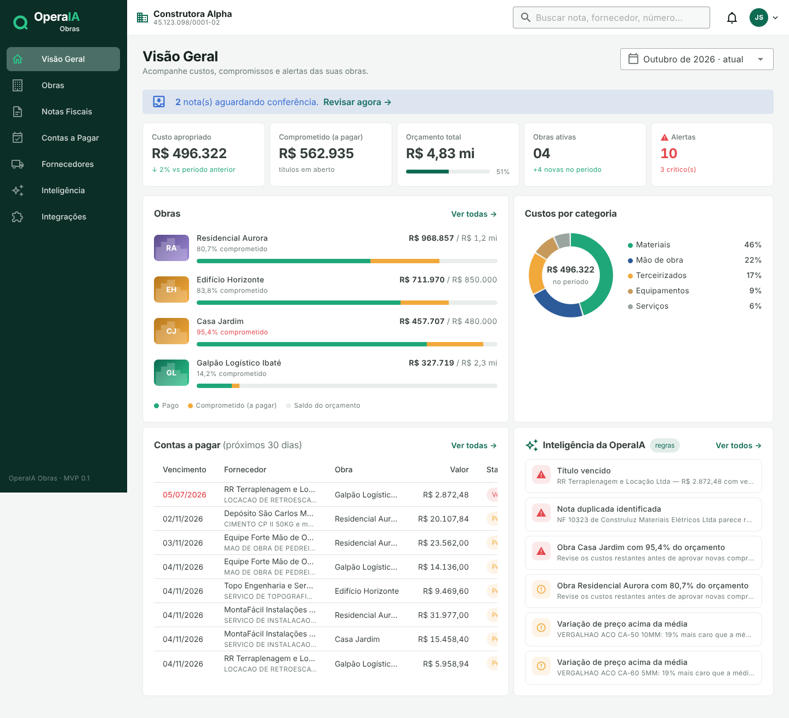

# OperaIA Obras

**Toda despesa na obra certa. Todo compromisso financeiro visível. Toda inconsistência importante identificada.**



Plataforma de inteligência operacional para construtoras. O MVP cobre o fluxo financeiro-documental, da nota fiscal à margem da obra:

`Recebimento → Leitura → Validação → Vínculo com a obra → Registro (custo + títulos) → Alertas`

## O que já funciona (MVP 0.1)

| Área | O que faz |
| --- | --- |
| **Notas Fiscais** | Upload de vários XMLs de NF-e de uma vez (ou PDF para digitação). A leitura do XML é determinística: emitente, destinatário, itens, duplicatas e informações complementares. |
| **Validação** | Confere a chave de acesso (DV), o CNPJ do emitente, se o destinatário é a construtora, o protocolo SEFAZ e a soma de itens e parcelas. Detecta duplicidade, fornecedor bloqueado e fornecedor novo. Reenviar o mesmo XML não duplica. |
| **Vínculo** | Sugere a obra pelo código ou nome citado na nota, ou pelo histórico do fornecedor. Sugere a categoria pelo fornecedor, por palavras-chave e pelo NCM. Toda sugestão diz o motivo. |
| **Aprovação** | Rateio entre obras e categorias, com conferência exata de centavos. Gera os títulos a partir das duplicatas do XML (editáveis). Se houver pendência crítica, exige confirmação explícita. Tudo fica auditado. |
| **Contas a Pagar** | Títulos em aberto, vencidos e pagos. Registro de pagamento total ou parcial (não movimenta dinheiro). Cancelar nota é bloqueado se já houver pagamento. |
| **Obras** | Orçamento total e por categoria, pago × a pagar × saldo, % comprometido, e as notas e títulos da obra. |
| **Inteligência** | Alertas por regras explicáveis: orçamento (80% atenção, 90% crítico, acima de 100% estourado), categoria acima do orçado, duplicidade, variação de preço acima de 15% da média do fornecedor, oportunidade de economia (outro fornecedor mais barato), títulos vencendo ou vencidos, nota sem obra, destinatário divergente. |
| **Fornecedores** | Cadastro automático a partir das notas, homologação e bloqueio, categoria padrão, total comprado. |
| **Integrações** | Endpoint com chave por construtora para o n8n enviar XMLs recebidos por e-mail. |
| **Segurança** | Login JWT, perfis (Admin, Financeiro, Gestor de obra), isolamento por construtora em toda consulta, trilha de auditoria. |

> Regra de ouro: **a IA interpreta e sugere; o sistema transacional valida e registra.** Nesta versão as sugestões são regras determinísticas. O GRIOT entra depois como mais um "sugestor", nunca como quem decide.

## Stack

- **Front:** Vue 3 + TypeScript + Vuetify 3 + Pinia + Vite (`apps/web`)
- **API:** Fastify 5 + TypeScript + Zod (`apps/api`)
- **Banco:** PostgreSQL 16 + **Drizzle ORM**, com migrations SQL versionadas em `apps/api/drizzle/`
- Monorepo com pnpm workspaces

**Por que Drizzle e não Prisma:** o MVP foi construído num ambiente sem acesso aos binários do Prisma. O Drizzle é 100% TypeScript, não tem engine binária e gera SQL legível, o que facilita o deploy na VPS. O schema fica em `apps/api/src/db/schema.ts`.

## Rodando localmente

```bash
pnpm install

# 1. banco (ou use um PostgreSQL que você já tenha)
docker compose up -d

# 2. configuração
cp apps/api/.env.example apps/api/.env   # ajuste DATABASE_URL e JWT_SECRET

# 3. estrutura + dados de demonstração (Construtora Alpha, ~125 notas fictícias)
pnpm db:migrate
pnpm db:seed

# 4. API (porta 3333) + front (porta 5173)
pnpm dev
```

Acesse http://localhost:5173 com **admin@alpha.com.br / operaia123**. Também existem `financeiro@alpha.com.br` e `obra@alpha.com.br`, com a mesma senha.

Para testar o upload, gere XMLs de exemplo com `pnpm --filter @operaia-obras/api fixtures` e arraste os arquivos de `apps/api/fixtures/` na tela **Notas Fiscais**:

| Arquivo | O que exercita |
| --- | --- |
| 01 | Caminho feliz |
| 02 | Nota sem obra |
| 03 | Preço alto |
| 04 | Outro destinatário |
| 05 | Fornecedor novo (bom para testar rateio) |

### Comandos úteis

| Comando | O que faz |
| --- | --- |
| `pnpm test` | Testes do domínio + teste ponta a ponta da API (usa o banco do `.env`) |
| `pnpm db:reset` | Apaga tudo, migra e roda o seed de novo (bloqueado em produção) |
| `pnpm --filter @operaia-obras/api db:generate` | Gera migration após alterar `schema.ts` |
| `pnpm build` | Type-check e build de produção |

## Integração por e-mail (n8n)

Em **Integrações** (perfil Admin) aparecem a chave e um exemplo de chamada:

```bash
curl -X POST https://SEU_DOMINIO/api/integrations/nfe \
  -H "x-api-key: <chave>" -H "x-source: email" \
  -H "Content-Type: application/xml" --data-binary @nota.xml
```

Fluxo sugerido no n8n:

1. Gatilho IMAP na caixa de notas.
2. Filtrar os anexos `.xml`.
3. HTTP Request para o endpoint acima.

## Estrutura

```
apps/api/src/
  domain/       parser NF-e, CNPJ/chave, dinheiro em centavos, classificador (com testes)
  services/     documentos, financeiro das obras, alertas, dashboard, auditoria
  db/           schema Drizzle, migrate, seed, reset
  dev/          gerador de XML fictício (testes, seed e fixtures)
  routes.ts     API REST
apps/web/src/
  views/        Visão Geral, Obras, Obra, Notas Fiscais, Contas a Pagar, Fornecedores, Inteligência, Integrações
  components/   DocumentReview (conferência e aprovação), UploadZone, DonutChart, StackBar…
```

## Definições usadas nos números

| Termo | Definição |
| --- | --- |
| **Custo apropriado** | Soma das notas **aprovadas** atribuídas à obra (por data de emissão no período). |
| **Pago** | Parte do custo apropriado cujos títulos já foram pagos. |
| **Comprometido (a pagar)** | Parte do custo apropriado com títulos em aberto. |
| **% comprometido** | (pago + a pagar) ÷ orçamento. |

Notas rateadas distribuem pago e a pagar proporcionalmente entre as obras. Valores monetários são guardados em centavos inteiros.

## Próximos passos sugeridos

Veja [`docs/ROADMAP.md`](docs/ROADMAP.md).
